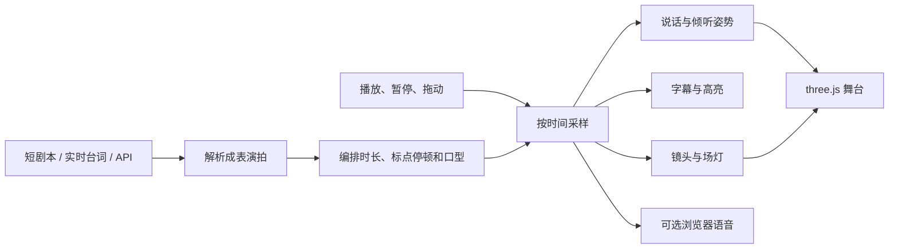

# 设计 · 《罗密欧与朱丽叶》表演台

## 演员与视觉

两位演员的脸、眼睛、发束和服装由 three.js 几何构造。罗密欧穿深青织锦，朱丽叶穿酒红礼服，以金属饰边和浅色领口衬出脸部动作。全景以尖拱和幕布围出表演区，灯笼和斜入的月光把演员从雾中的城镇分开。中景保留手和接戏的演员，现场特写转进角色视线内侧。表情图谱的特写使用低对比背景，固定在相近的正侧面机位。情绪主要改变辅光和轮廓光，肌肤延续暖色主光。

控制台使用中文。舞台与字幕占主要视野，表演面板提供演员、情绪、强度、动作、自定义台词、镜头和灯光选择。播放条负责播放、暂停、定位、拖动和逐帧检查。字幕采用可收起的独立区域。多行剧本可用表演指令重复同一个表演设置，便于修改一处情绪再比较。

## 时间线与输入

每一拍携带角色、台词、情绪权重、强度和动作标签。导演把每拍的相对时间换成场景时间。每次采样都能找出说话者、当前口型、字幕高亮和相机目标。暂停留在选定时间，拖动从新位置重新取样。原脚本、试演台词和外部调用都能进入同一套时序。语法与调用示例见 [表演 API](PERFORMANCE_API.md)。

汉字先转为拼音，再把一个音节的发音经过拆成声母、主要元音与收尾，按相邻形状插值。字符时间给字幕和口型一起使用。Web Speech 作为可选的声音层，静音与缺少可用语音时仍能完整演出。不同语音引擎的速度与事件粒度会影响配音效果。

## 表演合成

- **面部。** 左右眉、眼睑和唇角用独立的几何参数控制。表情强度决定动作幅度，情绪权重可在同一拍叠加。台词口型主要影响嘴唇张开和收圆，嘴角和眉眼维持表情。脸颊、鼻翼和下颌也随表情变形。眨眼短促，视线用小幅快速变化表现扫视，较慢的头部转动保持动作连续。
- **身体。** 姿态以肩、脊柱、头和重心表达。手部动作在准备、发力、保持与回落间过渡，肘部由腕部位置反解，手腕独立转向以表达递手、指向或贴近身体。每个动作按剧情拍的相对时间展开，呼吸和重心微移贯穿动作。指向、伸手、捂胸、抱头、转身、下跪适合用来检查剪影和关节过渡。
- **倾听。** 听者注视同台角色，适时点头、移开视线或露出反应。说话者和听者共享场景时间，方便在双人镜头检视谁先察觉、谁随后开口。
- **导演。** 自动镜头从交代空间的全景进入对话中景，再在情绪峰值拉近。推镜沿场景时间推进。手动机位适合逐帧查看；灯光预设控制主光、补光和轮廓光的关系，让情绪着色与面部可读性可以单独比较。

舞台由 Vite 构建为静态文件，相对资源路径允许在仓库子目录托管。首轮验证用 Playwright 与 Chromium 软件渲染，按情绪、台词帧序列、全景和控制台保存截图，另测持续播放时的动画帧率。

## 后续两轮

| 轮次 | 目标和验收 |
| --- | --- |
| 第一轮 | 完成同台演出、可读的表情和可拖动的普通话字幕与口型，验证实时试演、自动调度、镜头和灯光。保留截图序列及软件渲染帧率作为基线。 |
| 第二轮 | 对照逐帧截图细修眼睑贴合、唇齿接触、侧脸和多音字读法。校对角色互视、伸手和下跪时的接触与重心，比较相同台词在几组混合情绪下的区别。 |
| 第三轮 | 打磨整幕调度，并为另一段短戏验证同一 API。完善键盘操作、窄屏构图和性能边界。检查更换角色模型或导入已对齐配音时能否继续沿用时间线与表演参数。 |
